<h1 align="center">Space-Aware World Models:<br>Spatial Persistence Through Factored Scene Representations</h1>

<h3 align="center">Bruno Corcuera &nbsp;·&nbsp; Carlos Eiras-Franco &nbsp;·&nbsp; Brais Cancela</h3>

<p align="center">Universidade da Coruña &nbsp;·&nbsp; CITIC Research Center</p>

<p align="center"><b>NeurIPS 2026</b></p>

<p align="center"><i>A generative world model that holds scene content in a persistent latent code, encoded from a map or sampled from its prior,<br>and evolves only an explicit agent state, so revisited places stay consistent across long imagined trajectories.</i></p>

<p align="center"></p>

## Method

SWM separates what stays fixed during an episode from what moves. The scene code $z$ is inferred once from the top-down map $\mathbf{m}$. Only the explicit agent state $s_t$ evolves. Every frame is rendered from the pair:

```math
z \sim q_\phi(z \mid \mathbf{m}), \qquad s_{t+1} = s_t + T_\psi\big(\pi_s(s_t), z, \pi_a(a_t)\big), \qquad \hat{o}_t = G_\theta\big(z, \pi_s(s_t)\big)
```

**Scene encoder** $q_\phi$ (`src/models/dds_vae.py`). A two-stage VAE [[1]](#references) over the 128×128 map, built on dynamic feature selection [[2]](#references).
- Stage 1 is a deterministic compression backbone. A selection UNet feeds DDS gates (hard-concrete gates with a per-map top-k mask over input units), and learned downscaling produces a bottleneck $\mathbf{h} \in \mathbb{R}^{16\times16\times16}$. An upscaling path and a refinement UNet reconstruct $\mathbf{m}$ under MSE + L1.
- Stage 2 freezes the backbone and fits a small VAE on $\mathbf{h}$, with $\lVert \hat{\mathbf{h}} - \mathbf{h} \rVert^2 + \beta\, \mathrm{KL}\big(q_\phi(z \mid \mathbf{m}) \,\Vert\, \mathcal{N}(0, I)\big)$ and an annealed $\beta$.

Held-out maps embed without per-scene optimization, and scene codes can also be sampled from the prior.

**Observation model** $G_\theta$ (`src/models/generator.py`). The state passes through Fourier features [[3]](#references) to overcome the spectral bias of MLPs on low-dimensional inputs [[4]](#references). It is projected to the scene-code width and fused additively with $z$:

```math
\gamma(s) = \big[\sin(2^k \pi c\, s),\ \cos(2^k \pi c\, s)\big]_{k<L}, \qquad f_t = \alpha z + (1-\alpha)\, W\gamma(s_t), \qquad \alpha = \epsilon + (1 - 2\epsilon)\, \sigma(a)
```

$\alpha$ is a single learned scalar, bounded to $[\epsilon, 1-\epsilon]$ so that neither pathway can be switched off. A residual MLP (RMSNorm, SiLU) and a convolutional decoder map $f_t$ to a 96×96 RGB frame. The loss is $\lVert \hat{o}_t - o_t \rVert^2 + \lambda\, \mathrm{LPIPS}(\hat{o}_t, o_t)$ [[5]](#references), with a fresh reparameterized scene code per episode at every epoch. With $z$ fixed and $G_\theta$ deterministic, $s_i = s_j$ implies $\hat{o}_i = \hat{o}_j$: a revisited state receives the same renderer input.

**Transition model** $T_\psi$ (`src/models/transition.py`). The state is encoded with its own Fourier features, $\pi_s(s) = \mathrm{RMSNorm}(W_s\gamma(s))$, and the action with $\pi_a(a) = \mathrm{SiLU}(\mathrm{LN}(W_a a))$. An LSTM over the concatenated inputs predicts the increment in standardized units, rescaled with the training-set mean $\mu_\Delta$ and standard deviation $\sigma_\Delta$:

```math
\mathbf{h}_t = \mathrm{LSTM}\big(W_\text{in}\,[\pi_s(s_t);\, z;\, \pi_a(a_t)],\ \mathbf{h}_{t-1}\big), \qquad \Delta s_t = (\Delta x_t, \Delta y_t, \Delta\theta_t) = \mu_\Delta + \sigma_\Delta \odot \mathrm{MLP}(\mathbf{h}_t)
```

Position is integrated additively. Heading is integrated in angle space and mapped back to sine–cosine features, so the renderer input stays continuous:

```math
(x, y)_{t+1} = (x, y)_t + (\Delta x_t, \Delta y_t), \qquad \theta_{t+1} = \operatorname{atan2}(\sin\theta_t, \cos\theta_t) + \Delta\theta_t, \qquad s_{t+1} = (x_{t+1}, y_{t+1}, \sin\theta_{t+1}, \cos\theta_{t+1})
```

Training uses teacher forcing on the weighted squared error of the standardized increments, in fp32 with TF32 disabled to limit accumulated rollout error:

```math
\mathcal{L}_T = \sum_t \Big\lVert \mathbf{w} \odot \frac{\Delta\hat{s}_t - \Delta s_t}{\sigma_\Delta} \Big\rVert^2
```

Checkpoints are selected by free-running error, rolling $s_{t+1} = s_t + \Delta\hat{s}_t$ from $s_0$ under the recorded actions. The state carries no wall information, so contacts with walls must be predicted from $z$.

The three models are trained in sequence on precomputed scene codes, using PyTorch and Lightning with pyrallis dataclass configs. Each run logs TensorBoard metrics, its training FLOPs (`flops.json`), and CodeCarbon energy use (`emissions.csv`).

## DMLab environment

`src/envs/dm_lab_maze.py` wraps the procedural maze level of DeepMind Lab [[6]](#references) (`third_party/deepmind_lab/random_maze_safe.lua`, built on the lasertag procedural factory without bots). The maze parameters come from Python:
- 13×13 mazes with up to four rooms of 3–5 cells;
- pickups;
- one maze per seed.

| Quantity | Definition |
| --- | --- |
| Scene map $\mathbf{m}$ | Engine top-down camera, 128×128 RGB, one per episode. All maps span the same world range $[50, 1250]^2$. |
| Observation $o_t$ | First-person RGB, rendered at 128×128 and stored at 96×96 |
| Raw state | $(x, y, \theta)$ from the engine's debug position and rotation |
| State $s_t$ | $(x_n, y_n, \sin\theta, \cos\theta)$, positions scaled to $[-1, 1]$ with $y$ following image rows |
| Increment $\Delta s_t$ | $(\Delta x_n, \Delta y_n, \Delta\theta)$, heading wrapped to $[-\pi, \pi)$ |
| Action $a_t$ | $(\text{turn}, \text{forward})$ from DMLab's 7-dim action: turn in $[-90, 90]$ scaled to $[-1, 1]$, forward in $\{0, 1\}$ |

Each step repeats the action for two engine frames at 30 fps. The rollout dataset stores $o_t$, raw states and actions, rewards, done flags, and one map per episode in HDF5. Parallel workers write it as resumable shards. Episode seeds are `base_seed + episode_id`, so every rollout can be regenerated exactly. The viewers load `src/envs/dmlab_levels/interactive_maze.lua`, which extends the same level with a teleport property for placing the agent on the map.

## Fast-sweeping exploration

Rollouts are collected without a pretrained navigator. Random policies cover the maze poorly and get trapped locally, so the data comes from a planner that reads the same top-down map SWM later encodes (`src/envs/dmlab_autonomous_exploration/`, `src/datasets/make_rollouts_dmlab.py`).

<p align="center"></p>

**Occupancy and waypoints.** The map is segmented into a walkable grid by color distance to the wall color, with borders cropped and free space eroded away from walls. The agent cycles through the map center and four inset corners, each snapped to the nearest walkable cell by breadth-first search.

**Travel-time field.** For a waypoint $\mathbf{x}_g$, the planner solves the eikonal equation on the 128×128 grid. The speed $F$ drops near walls: $d_\text{wall}$ comes from a Euclidean distance transform of the occupancy grid, so routes follow corridor centers instead of hugging corners:

```math
\lvert \nabla T(\mathbf{x}) \rvert = \frac{1}{F(\mathbf{x})}, \quad T(\mathbf{x}_g) = 0, \qquad F(\mathbf{x}) = \frac{1}{1 + \lambda\, e^{-d_\text{wall}(\mathbf{x}) / r}}, \qquad F = 0 \text{ on walls}
```

The fast sweeping method [[7]](#references) solves it with a Godunov upwind discretization. Cell $(i, j)$ with $c = 1/F_{ij}$ and unit spacing takes the smallest upwind neighbors in each axis:

```math
a = \min(T_{i-1,j},\, T_{i+1,j}), \quad b = \min(T_{i,j-1},\, T_{i,j+1}), \qquad
\bar{T}_{ij} = \begin{cases} \min(a, b) + c & \lvert a - b \rvert \ge c \\ \tfrac{1}{2}\big(a + b + \sqrt{2c^2 - (a - b)^2}\big) & \text{otherwise} \end{cases}, \qquad T_{ij} \leftarrow \min(T_{ij}, \bar{T}_{ij})
```

- **Sweep orderings.** The update is applied in place, Gauss–Seidel style, in the four orderings $(i\!\uparrow, j\!\uparrow)$, $(i\!\uparrow, j\!\downarrow)$, $(i\!\downarrow, j\!\uparrow)$, $(i\!\downarrow, j\!\downarrow)$. Each ordering propagates information along the characteristics of one quadrant, so a few rounds of four sweeps cover a maze.
- **Cost.** Each sweep is a plain $O(N)$ pass over the grid, with no priority queue as in fast marching [[8]](#references). The loops are compiled with Numba, and the field is recomputed only when the waypoint changes.

**Control.** The agent at position $\mathbf{p}_t$ with heading $\theta_t$ steers toward the lowest-travel-time cell in a local window:

```math
\mathbf{g}^* = \operatorname*{arg\,min}_{\lVert \mathbf{g} - \mathbf{p}_t \rVert_\infty \le R} T(\mathbf{g}), \qquad \delta_t = \operatorname{wrap}\big(\operatorname{atan2}(\mathbf{g}^* - \mathbf{p}_t) - \theta_t\big)
```

It turns in place when $\lvert\delta_t\rvert$ is large and otherwise moves forward with small heading corrections. A waypoint counts as reached once $T(\mathbf{p}_t)$ falls below a threshold. A stall, detected from the displacement over a window of recent positions, switches to the next waypoint.

**Perturbations.** Pure gradient descent on $T$ gives near-deterministic shortest paths. The default `balanced` policy adds four perturbations:
- a sinusoidal slalom with a random phase, frequency, and amplitude per episode;
- a slowly drifting heading offset;
- short random-action bursts;
- in-place look-around turns.

All four are damped in narrow corridors, which are detected from the local free-space ratio. They widen state and viewpoint coverage without leaving the walkable region. The policy is selected with `--policy` (`balanced`, `fast_sweeping`, `slow_fast_sweeping`, `random`).

## Installation

Create a Python 3.11 environment and install the pinned dependencies (PyTorch 2.6, CUDA 12.4):

```bash
conda create -n swm python=3.11 && conda activate swm
pip install -r requirements.txt --extra-index-url https://download.pytorch.org/whl/cu124
```

**DeepMind Lab** is not on PyPI. It is built from source as a Python wheel and installed into the same environment. Install the system packages listed in DeepMind Lab's `docs/users/build.md` (C++ toolchain, SDL2, OSMesa, Lua 5.1, and others) and [Bazelisk](https://github.com/bazelbuild/bazelisk). `third_party/deepmind_lab/build.patch` updates the upstream build for current toolchains:
- pins Bazel 6.5.0 through `.bazelversion` (Bazelisk fetches it) and disables Bzlmod;
- declares `rules_cc` and `rules_python`, and pins `abseil-cpp` to a release tag instead of `master`;
- builds the extension for Python 3 only, against the headers of the `python3` on `PATH`;
- drops the `pkg_resources` dependency from the package loader.

Because of the third change, build with the SWM environment activated, so that the extension matches its Python and NumPy. The maze level used by SWM is copied into the source tree before building, so it is packaged with the wheel:

```bash
git clone https://github.com/google-deepmind/lab.git && cd lab
git apply <swm>/third_party/deepmind_lab/build.patch
cp <swm>/third_party/deepmind_lab/random_maze_safe.lua game_scripts/levels/contributed/dmlab30/
bazel build -c opt //python/pip_package:build_pip_package
./bazel-bin/python/pip_package/build_pip_package /tmp/dmlab_pkg
pip install /tmp/dmlab_pkg/deepmind_lab-*.whl
python -c "import deepmind_lab"
```

To render scene maps with a build used from `bazel-bin` without installing the wheel, pass its runtime assets to `make_topdown_views_dmlab` with `--runfiles_path`.

## Usage

Settings are dataclasses in `src/configs/`, and every field can be set from the command line.

```bash
python -m src.datasets.make_topdown_views_dmlab                    # scene maps
python -m src.datasets.make_rollouts_dmlab                         # exploration rollouts (HDF5)
python -m src.training.train_dds_vae                               # scene encoder
python -m src.training.train_generator  --scene_encoder <dds_vae>  # observation model
python -m src.training.train_transition --scene_encoder <dds_vae>  # transition model
```

## Code structure

- **`src/configs/`** holds one dataclass per component, parsed by pyrallis.
  - `dmlab.py` defines the world range and the transforms between simulator coordinates and $s_t$, $a_t$, $\Delta s_t$.
  - `datasets.py` configures scene-map and rollout generation.
  - `dds_vae.py`, `generator.py`, and `transition.py` hold model and optimization settings.
- **`src/envs/`** holds the environment code.
  - The DMLab maze wrapper resets by seed, caches the top-down map, and resets automatically at episode end.
  - `DMLabSimulator` serves episodes to the viewers in the dataset's conventions.
  - The Lua levels live here.
  - `dmlab_autonomous_exploration/` holds map segmentation, world–grid mapping, fast-sweeping distance maps, the steering controller, and the waypoint manager.
- **`src/datasets/`** holds data generation and loading.
  - The map and rollout generation scripts.
  - `generation.py` runs parallel, sharded, resumable episode writing and the final merge.
  - `maps.py` provides the map dataset and its splits.
  - `rollouts.py` provides episode splits, per-episode scene encoding, and frame and sequence-window datasets.
- **`src/models/`** holds the three models. `layers.py` holds the Fourier features shared by the observation and transition models.
- **`src/training/`** holds the three entry points.
  - `utils.py` covers versioned run directories, the cosine schedule, the shared Lightning `fit`, CSV and TensorBoard logging, preview images, and summary plots.
  - `callbacks.py` counts training FLOPs and tracks energy with CodeCarbon.
- **`assets/`** holds the README figures and the scripts that draw them, with shared SVG helpers in `svg_utils.py`.

## Tools

`src/tools/` holds pygame viewers and a benchmark that run on trained checkpoints. `render_models.py` loads compatible checkpoints and encodes scene maps to posterior means. `render_utils.py` holds the shared window and drawing helpers. Keyboard and mouse controls are listed in each module's docstring.

| Module | What it does |
| --- | --- |
| `render_transition` | Drives the simulator and the free-running SWM with the same keyboard actions. Shows the simulator view, renders at the simulator and predicted states, and both trajectories on the map. Resynchronizes on demand. |
| `render_generator` | Compares the simulator observation with $G_\theta(z, s_t)$ at the same state while driving or teleporting on the map, next to the decoded scene code. |
| `render_prior_scenes` | Samples $z = \tau\varepsilon$ with $\varepsilon \sim \mathcal{N}(0, I)$, decodes the map, and navigates the sampled scene with $T_\psi$ and $G_\theta$. Supports temperature presets, editing of individual code entries, and optional MP4 capture per scene. |
| `render_dds_vae_latent` | Explores the scene-code space: posterior means of dataset maps, PCA plane and sliders, per-dimension edits, map interpolation, and prior samples. |
| `render_fast_sweeping_dmlab` | Runs the exploration policy live with the observation, the travel-time field replayed sweep by sweep, and the descent route. |
| `render_rollout_dataset` | Plays recorded HDF5 episodes with the trajectory on the scene map. |
| `benchmark_swm_speed` | Measures SWM as a simulator: frames per second for one environment and the largest batch of parallel environments that keeps a target rate, on GPU and CPU. Writes JSON, which `assets/make_speed_chart.py` plots. |

```bash
python -m src.tools.render_transition --checkpoint <transition.ckpt> --generator <generator.ckpt>
```

## Notebooks

| Notebook | What it shows |
| --- | --- |
| `dataset.ipynb` | Scene-map PNG datasets and rollout HDF5 files: sample maps, episodes, and their contents. |
| `dds_vae.ipynb` | A trained scene encoder on held-out maps. The pipeline from map through DDS selection and bottleneck to the reconstructions; prior samples and interpolations; per-dimension KL, the aggregate posterior against $\mathcal{N}(0, 1)$, and Kolmogorov–Smirnov distances; a UMAP density of posterior means; latent traversals; posterior temperature; and an interactive slider explorer. |
| `transition.ipynb` | A trained transition model on complete held-out episodes. Free-running trajectories on the scene map; rollout against one-step error as it accumulates over steps and beyond the training window; predicted states inside walls and their signed distance to the nearest wall; and a scene-code ablation (own, shuffled, prior, and zero codes). |
| `fast_sweeping_dmlab.ipynb` | The exploration planner step by step: segmentation and waypoints, wall-aware speed, the local eikonal update, Gauss–Seidel sweeps and their convergence, descent routes, steering, and one field per waypoint. |

## License

MIT, see [LICENSE](LICENSE). Files in `third_party/deepmind_lab/` derive from DeepMind Lab and are distributed under the GNU GPL v2.0, see [third_party/deepmind_lab/LICENSE](third_party/deepmind_lab/LICENSE).

## References

1. D. P. Kingma, M. Welling. [Auto-Encoding Variational Bayes](https://arxiv.org/abs/1312.6114). ICLR, 2014.
2. B. Corcuera, C. Eiras-Franco, B. Cancela. [Unsupervised Dynamic Feature Selection for Robust Latent Spaces in Vision Tasks](https://arxiv.org/abs/2510.01758). arXiv:2510.01758, 2025.
3. M. Tancik et al. [Fourier Features Let Networks Learn High Frequency Functions in Low Dimensional Domains](https://arxiv.org/abs/2006.10739). NeurIPS, 2020.
4. N. Rahaman et al. [On the Spectral Bias of Neural Networks](https://arxiv.org/abs/1806.08734). ICML, 2019.
5. R. Zhang, P. Isola, A. A. Efros, E. Shechtman, O. Wang. [The Unreasonable Effectiveness of Deep Features as a Perceptual Metric](https://arxiv.org/abs/1801.03924). CVPR, 2018.
6. C. Beattie et al. [DeepMind Lab](https://arxiv.org/abs/1612.03801). arXiv:1612.03801, 2016.
7. H. Zhao. [A Fast Sweeping Method for Eikonal Equations](https://doi.org/10.1090/S0025-5718-04-01678-3). Mathematics of Computation, 74(250):603–627, 2005.
8. J. A. Sethian. Level Set Methods and Fast Marching Methods. Cambridge University Press, 1999.
